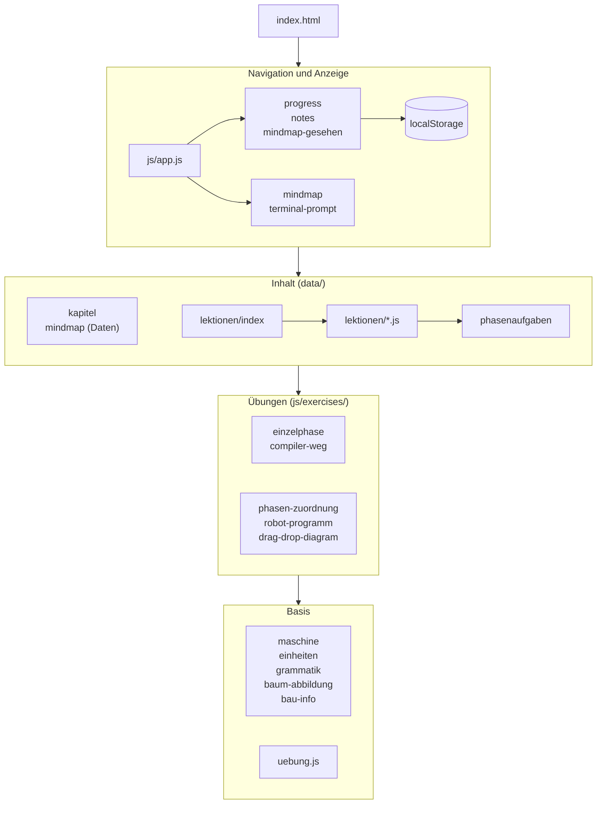
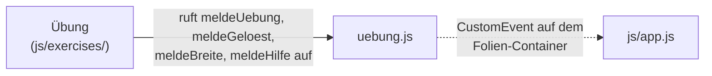
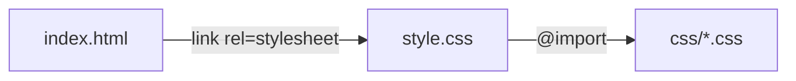

# Interaktive Lehreinheit für die Programmierlehre zum Thema Zusammenspiel von Compiler und Laufzeitumgebung
Diese interaktive Lehreinheit für die Programmierlehre richtet sich an Erstsemester ohne Programmiererfahrung. Sie zeigt, wie sich ein abstraktes Thema durch Interaktion und Gamification-Elemente erfahrbar machen lässt.

Als Beispiel dient das Zusammenspiel von Compiler und Laufzeitumgebung. Roter Faden ist ein Roboter, der über eine einfache Programmiersprache gesteuert wird. Mit jedem Kapitel kommen neue Programmierkonzepte hinzu, und die Lernenden verfolgen, wie sich diese auf die Phasen des Compilers und auf die Laufzeitumgebung auswirken.

<br>

# Projektaufbau

## Ordnerstruktur
```
index.html            Gerüst, lädt nur js/app.js
style.css             Liste von @import-Zeilen auf css/
build.js              Build der Einzeldatei (esbuild)
data/
  kapitel.js          Inhaltsverzeichnis: Kapitel, Titel, Lektions-IDs
  lektionen/          eine Datei pro Lektion (z. B. 3-2.js), index.js sammelt alle
  mindmap.js          Begriffe der Mindmap
  phasenaufgaben.js   Karten des Quiz (6.1 und Ende von Kapitel 2 bis 5)
js/
  app.js              Knotenpunkt: Navigation, Anzeige, Pop-ups, Export/Import
  progress.js         Fortschritt (localStorage)
  notes.js            Kommentare zu Folien (localStorage)
  mindmap.js          Mindmap-Komponente
  mindmap-gesehen.js  "neu"-Punkte der Mindmap (localStorage)
  grammatik.js        HTML-Bausteine für Grammatikregeln
  baum-abbildung.js   statische Syntaxbaum-Abbildung für Lektionstexte
  uebung.js           Meldungen der Übungen an app.js
  einheiten.js        rem()-Hilfe für Längen, die aus JS gesetzt werden
  bau-info.js         Build-Datum und Prüferversion (Info-Pop-up)
  terminal-prompt.js  Terminalzeile im Hauptmenü (Animation)
  exercises/
    robot-programm.js                  Programmiere den Roboter, 1.1
    drag-drop-diagram.js               Vervollständige die Übersetzungswege, 1.3
    phasen-zuordnung.js                Ordne den Phasen zu, 6.1 und am Ende von Kapitel 2 bis 5
    einzelphase.js                     eine Phase pro Folie, Kapitel 2 bis 5
    compiler-weg.js                    Durchlaufe alle Phasen 6.2
    compiler-weg-lexik.js              Werde zum Scanner
    compiler-weg-syntax.js             Werde zum Parser
    compiler-weg-semantik.js           Prüfe den Baum (Oberfläche)
    compiler-weg-semantik-regeln.js    Prüfe den Baum (Regeln und Prüfschritte)
    compiler-weg-ast.js                baut aus den Tokens den Baum für die Semantik
    compiler-weg-codegen.js            Übersetze den Code (Oberfläche)
    compiler-weg-codegen-muster.js     Generator der Musterübersetzung
    compiler-weg-codegen-pruefung.js   Läufer und Prüfung der Übersetzung
    compiler-weg-laufzeit-faecher.js   Lader und Laufzeitsystem
    maschine.js                        gemeinsamer Befehlssatz, Register, Speicher
    phasen-hilfe.js                    Hilfetexte der Phasen
    baum-scroll.js                     zentriert Knoten in der Baumfläche
css/                  nummerierte Teile des Stylesheets
assets/               SVG-Icons
dist/                 Build-Ergebnisse
```

## Schichten und Abhängigkeiten

- Inhalt (`data/`), Navigation (`js/app.js`) und Aussehen (`css/`) sind strikt getrennt. Eine Lektion weiß nichts von der Navigation, `app.js` nichts vom Inhalt einer Lektion.
- Ein Pfeil von einer Schicht zur nächsten gilt auch für die Schichten dahinter: `app.js` importiert zusätzlich `bau-info.js` und `uebung.js`, die Lektionen importieren zusätzlich `grammatik.js` und `baum-abbildung.js` aus der Basis.
- `app.js` importiert keine Übung, und keine Übung importiert `app.js`. Sie teilen sich nur `uebung.js`, also die Ereignisnamen und die Meldefunktionen.
- Die Lektionen importieren die Übungen und geben ihnen den Inhalt über `config` mit.

#### Meldeweg der Übungen: 
Die einzige Verbindung von einer Übung zu `app.js`.



#### Stylesheet:
- Das Aussehen wird nicht über import eingebunden, sondern über index.html und style.css. 


- Die Reihenfolge der @import-Zeilen in style.css ist wichtig: Widersprechen sich zwei CSS-Regeln, gilt die, die später geladen wird.

## Anwendung starten

### Entwicklermodus
- Lokaler Server nötig, weil ES-Module nicht über `file://` laden
- `npx serve .`, dann die angezeigte Adresse öffnen
- Kein Build nötig

### Als einzelne Datei
- Node.js nötig, einmal `npm install`, dann `npm run build`
- Ergebnis: `dist/interaktive-lehreinheit_JJJJ-MM-TT.html`, läuft per Doppelklick
- `npm run build:pruefer` erzeugt die Prüferversion
- `dist/` nie von Hand bearbeiten
- Fortschritt und Kommentare liegen im `localStorage`, Sicherung über "Daten exportieren/importieren" im Menü

## Ablauf der Anwendung
- Es gibt drei Screens: Hauptmenü, Kapitelübersicht (als Liste oder als Mindmap) und Lektion.
- Einstellungen, Info und Hilfe sind Pop-ups und keine Screens. Sie schließen sich dorthin, wo man war.
- Der Ort in der Anwendung liegt in einem Objekt `state` (`screen`, `lessonId`, `slideIndex`, `chapterView`). Nur `goto()` und `setChapterView()` ändern es und rendern neu.
- Reiner Oberflächenzustand (aufgeklappte Kapitel, Kommentarfeld, besuchte Folien) liegt bewusst außerhalb von `state`.
- In der Lektion blättern die Pfeiltasten ← und → wie die Knöpfe unter der Folie, auch über Lektions- und Kapitelgrenzen. In Textfeldern und bei offenem Pop-up tun sie nichts.
- Zu jeder Folie gibt es ein eigenes Kommentarfeld. Es wird verzögert gespeichert, ohne die Folie neu zu rendern, damit eine laufende Übung nicht von vorn beginnt.

## Lektionen und Folien
- Eine Lektion ist eine Datei in `data/lektionen/` mit `export const LEKTION = { id, title, desc, slides }`. Der Titel beginnt mit der Nummer (`3.2 …`).
- Eine Folie hat eine `id`, einen `title` und entweder `text` (Absätze, optional `figure` als SVG-String) oder eine Funktion `render(container)`.
- Die Folien-`id` bleibt stabil, auch wenn Folien verschoben werden. Kommentare, Fortschritt und Mindmap hängen an ihr. Eine neue Folie bekommt eine neue, unbenutzte `id`.
- Startet ein `render` etwas Zeitbasiertes (Animation, Timer, Listener auf `window`), gibt es eine Aufräumfunktion zurück. `app.js` ruft sie vor der nächsten Folie auf.

## Übungen
Jede Übung ist ein Modul in `js/exercises/` mit `render(container, config)`. Die Lektion importiert sie und gibt ihren Inhalt über `config` mit. Mehrere Lektionen nutzen so denselben Code.

| Modul | Verwendung |
|---|---|
| `robot-programm.js` | 1.1: den Roboter mit Befehlsblöcken steuern |
| `drag-drop-diagram.js` | 1.3: Begriffe im Diagramm der Übersetzungswege zuordnen |
| `einzelphase.js` | Kapitel 2 bis 5: eine Compiler-Phase pro Folie (`config.phase`: `lexik`, `syntax`, `semantik`, `codegen`, `laufzeit`) |
| `compiler-weg*.js` | Die Phasen als Übung (Lexik, Syntax, Semantik, Codegenerierung, Laufzeit mit Prüfung). `compiler-weg.js` verkettet sie in 6.2 |
| `phasen-zuordnung.js` | Quiz in 6.1 und am Ende von Kapitel 2 bis 5 |
| `maschine.js` | Gemeinsamer Befehlssatz, Register und Speichergrößen |
| `phasen-hilfe.js` | Hilfetexte der Phasen |

- Eine Übung meldet sich über `js/uebung.js` bei `app.js` (`meldeUebung`, `meldeGeloest`, `meldeBreite`, `meldeHilfe`).
- Eine Lektion gilt als abgeschlossen, wenn alle Folien besucht und alle Übungen gelöst sind. `robot-programm.js` und die Sandbox in 6.2 melden sich bewusst nicht an und blockieren nichts.

## Mindmap und Hilfe
**Mindmap**
- `data/mindmap.js` enthält die Begriffe als Baum. Jeder Begriff hat einen festen Schlüssel und die Folie, die ihn einführt (`slide: '2-2/s3'`, Lektions-ID und Folien-ID, nicht die Position).
- Ein Begriff erscheint, sobald seine Folie besucht wurde. Das wird aus dem Fortschritt abgeleitet und nicht eigens gespeichert. Nur der Punkt „neu, noch nicht angeklickt“ liegt in `js/mindmap-gesehen.js`.
- Ein Klick auf einen Begriff öffnet seine Folie.
- `js/mindmap.js` zeichnet die Karte (Layout, Lupe, Zoom per Touch) und kennt weder Fortschritt noch Navigation. `renderMindmap()` in `app.js` verbindet beides.
- Beim Start prüft `pruefeBegriffe()`, ob jeder Verweis noch auf eine Folie zeigt, und meldet Fehler in der Konsole. Wer Folien-IDs ändert, merkt es sofort.

**Hilfe**
- Hauptmenü, Kapitelübersicht, Mindmap und Lektion haben je einen Hilfetext im Pop-up „Hilfe“.
- Jede Übung liefert ihren eigenen Hilfetext über `meldeHilfe` (`titel`, `html`). Die Texte der Compiler-Phasen liegen gesammelt in `js/exercises/phasen-hilfe.js`, damit Kapitel 2 bis 5 und die Sandbox in 6.2 dieselben Texte nutzen.
- In einer Lektion steht der Hilfetext der Übung oben, darunter die Bedienung der Lektion.

## Speicherung
- Fortschritt, Kommentare und die „neu“-Punkte der Mindmap liegen im `localStorage`, je Modul unter eigenem Schlüssel.
- Darstellung und Farbsicht sind Geräteeinstellungen und gehören nicht zum Export.
- Export und Import laufen über eine JSON-Datei (`compiler-laufzeitumgebung-lehreinheit-daten.json`) mit den Feldern `fortschritt`, `notizen` und `mindmap` (optional). Ein Import ersetzt den gespeicherten Stand vollständig.
- Grund für den manuellen Export: Bei `file://` teilen sich in Chrome alle lokalen HTML-Dateien denselben `localStorage`.

## Erweitern
**Neue Lektion**
1. Datei `data/lektionen/<id>.js` nach dem Muster der anderen anlegen.
2. In `data/lektionen/index.js` importieren und in `LESSONS` aufnehmen.
3. Die ID in `data/kapitel.js` beim passenden Kapitel eintragen.

**Neue Übung**
1. Datei in `js/exercises/` mit `render(container, config)` anlegen.
2. In der Lektionsdatei importieren und einer Folie geben: `render: (container) => renderXyz(container, { … })`. `app.js` bleibt unverändert.
3. Bei Zeitbasiertem eine Aufräumfunktion zurückgeben.

## Darstellung
- Die Einstellungen bieten hell und dunkel sowie einen Rot-Grün-Modus für Farbfehlsichtigkeit.
- Die Schriftgröße wächst mit der Fensterbreite, Größen sind in `rem`. Zusätzlich hilft der Browser-Zoom.
- Das Layout ist für Desktop und Tablet im Querformat gedacht, Smartphones werden nicht unterstützt.

<br>

# Inhaltlicher Aufbau
| Kapitel | Inhalt |
|---|---|
| 1 Einführung | Programm und Roboter, Hardware, Grundlagen des Compilers |
| 2 Konstanten und Roboterbewegung | Eine Mini-Sprache, einmal durch den ganzen Compiler |
| 3 Variablen und Rechnen | Register, Überlauf |
| 4 Verzweigungen | Vergleiche, Flag, Sprünge |
| 5 Schleifen | Rücksprung, Endlosschleife |
| 6 Der gesamte Weg | Quiz zu den Phasen (6.1), eigenes Programm durch alle Phasen (6.2) |

- Kapitel 2 bis 5 haben dieselbe Struktur: x.1 Einführung, x.2 Lexik, x.3 Syntax, x.4 Semantik, x.5 Codegenerierung, x.6 Laufzeit.
- Jedes dieser Kapitel nutzt ein Beispielprogramm. Die Sprache wächst von Kapitel zu Kapitel.

## Roboter
- Der Roboter ist die Maschine, auf der die Programme laufen. Er ist ein vereinfachtes Modell eines Computers.
- Modellhaft zeigt er drei Komponenten: die CPU, die Befehle ausführt, den Speicher, der Programm und Daten hält, und das Spielfeld, auf dem sichtbar wird, was das Programm tut.

### CPU
- Die CPU führt die Befehle nacheinander aus. Der Befehlszähler zeigt auf den nächsten Befehl.
- Sie hat ein Rechenwerk und die zwei Register `A` und `B`. Gerechnet und verglichen wird nur mit Registern und Zahlen, nie direkt mit Datenzellen.
- Das Flag speichert das Ergebnis des letzten Vergleichs (1 oder 0). Nur `jif` liest es.

### Speicher
- Programm und Daten liegen im selben Speicher mit 50 Fächern. Das Programm beginnt bei `[00]`, die Daten folgen direkt dahinter.
- Ein Fach enthält ein Byte, also eine Zahl von 0 bis 255.

### Spielfeld
- Der Roboter bewegt sich über das Spielfeld, ein 6×6-Raster. Fährt er über den Rand oder gegen ein Hindernis, ist das ein Laufzeitfehler.


## Befehlssatz Quellcode

| Anweisung | Beispiel | Bedeutung |
|---|---|---|
| Deklaration | `number n = 3;`, `boolean b = true;` | legt eine Variable mit Typ und Startwert an |
| Zuweisung | `n = n - 1;` | gibt einer deklarierten Variablen einen neuen Wert |
| Bewegung | `moveRight(2);`, `moveUp(n);` | der Roboter fährt so viele Felder in die Richtung, wie das Argument (Zahl oder Variable) angibt. Die Richtungen sind `moveUp`, `moveDown`, `moveRight` und `moveLeft` |
| Verzweigung | `if (n > 0) { … }` | der Block läuft nur, wenn die Bedingung wahr ist |
| Schleife | `while (n > 0) { … }` | der Block läuft so lange, wie die Bedingung wahr ist |

- Typen: `number` (0 bis 255) und `boolean` (`true`, `false`).
- Rechnen: `+ - * /` mit zwei Zahlen, das Ergebnis ist eine Zahl.
- Vergleichen: `< > <= >=` mit zwei Zahlen, `== !=` mit zwei Werten desselben Typs. Das Ergebnis ist ein Wahrheitswert.
- Ein Ausdruck besteht aus einem Wert oder aus zwei Werten mit einem Operator. Verschachtelte Rechnungen gibt es nicht.

## Befehlssatz Maschinencode

| Gruppe | Befehl | Bedeutung |
|---|---|---|
| Datentransfer | `mov Quelle Ziel` | kopiert eine Zahl, ein Register oder eine Datenzelle in ein Register oder eine Datenzelle |
| Rechnen | `+`, `-`, `*`, `/` (z. B. `+ A, 3`) | rechnet das erste Register mit einer Zahl oder einem Register, das Ergebnis steht im ersten Register |
| Vergleichen | `<`, `>`, `<=`, `>=`, `==`, `!=` (z. B. `<= A, 0`) | vergleicht zwei Werte (Zahl oder Register), das Ergebnis steht nur im Flag (1 oder 0) |
| Sprünge | `jmp Ziel` | springt immer |
| | `jif Ziel` | springt nur, wenn das Flag 1 ist |
| Roboter | `rgt`, `lft`, `up`, `dwn` | fährt nach rechts, links, oben oder unten. Die Anzahl ist eine Zahl oder eine Datenzelle, nie ein Register |
| Programmende | `end` | beendet das Programm |


## Die Phasen
Der Weg vom Quellcode zum laufenden Programm hat fünf Phasen. Die ersten vier bilden den Compiler, die fünfte ist das Laufzeitsystem.

| Phase | Eingabe | Ausgabe |
|---|---|---|
| Lexikalische Analyse | Quellcode (Zeichen) | Tokenliste |
| Syntaxanalyse | Tokenliste | Syntaxbaum |
| Semantische Analyse | Syntaxbaum | geprüfter Baum mit Typen |
| Codegenerierung | geprüfter Baum | Maschinencode |
| Laden und Ausführen | Maschinencode | laufendes Programm |

- In den Kapiteln 2 bis 5 übernehmen die Lernenden in jeder Phase die Rolle des Compilers an einem festen Beispielprogramm („Werde zum Scanner“, „Werde zum Parser“ …). In 6.2 laufen ihre eigenen Programme durch alle Phasen.
- Die Aufgabe steht im Folientitel, die Bedienung im Hilfe-Pop-up der Übung.
- Ein falscher Zug zeigt eine kurze Meldung („Falsch“), die Erklärung folgt erst auf „Zeige Hinweis“. Nach wiederholten Fehlern erscheint „Schritt vormachen“.
- Ein Fehler im Quellcode ist ein gültiges Ergebnis: Wer ihn richtig meldet, hat die Phase geschafft. Grün heißt „Geschafft“, orange „Falsch“, rot markiert einen Fehler im Programm.
- In den ersten drei Phasen kann das Programm abgelehnt werden. Die Codegenerierung lehnt nichts ab, die Laufzeit kann am Ende mit einem Laufzeitfehler abbrechen.

### Lexikalische Analyse
- Der Scanner zerlegt den Quellcode von links nach rechts in Tokens. Leerzeichen und Zeilenumbrüche werden überlesen.
- Ein Wort beginnt mit einem Buchstaben, danach folgen Buchstaben und Ziffern. Es ist ein Schlüsselwort, ein Literal (`true`, `false`) oder sonst ein Bezeichner.
- Das längste passende Token gewinnt: `<=` ist ein Token und nicht `<` und `=`.
- Ein Zeichen, das zu keinem Token passt, ist ein lexikalischer Fehler. Der Scanner liest nicht weiter.
- Übung: Die Lernenden lesen Zeichen für Zeichen und färben jedes Token mit dem passenden Werkzeug. Das Werkzeug „Lexikalische Fehler“ markiert das fehlerhafte Zeichen.

#### Tokens
- **Schlüsselwörter:** `number`, `boolean`, `if`, `while`, `moveUp`, `moveDown`, `moveRight`, `moveLeft`
- **Bezeichner:** selbst gewählte Namen (`a`, `weg`)
- **Literale:** ganze Zahlen und `true`, `false`
- **Operatoren:** `=`, `+`, `-`, `*`, `/`, `<`, `>`, `<=`, `>=`, `==`, `!=`
- **Gliederungszeichen:** `(`, `)`, `;`, `{`, `}`

### Syntaxanalyse
- Der Parser prüft, ob die Tokens der Grammatik folgen, und baut daraus den Syntaxbaum.
- Das erste Token einer Anweisung legt ihre Art fest: `number` oder `boolean` beginnt eine Deklaration, ein Bezeichner eine Zuweisung, `moveUp`, `moveDown`, `moveRight` oder `moveLeft` eine Bewegung, `if` eine If-Anweisung und `while` eine While-Anweisung.
- Ein Token an einer Stelle, an der die Grammatik es nicht erlaubt, ist ein Syntaxfehler.
- Übung: Die Lernenden ordnen das aktuelle Token ein und ziehen Sprachkonstrukte (Nichtterminale) aus der Ablage in den Baum. Ein Knopf „Syntaxfehler melden“ beendet die Phase. Die Syntaxregeln stehen im Pop-up.

#### Syntaxregeln
Der Pfeil liest sich als „besteht aus“, der senkrechte Strich als „oder“. Runde Klammern fassen zusammen, `[ … ]` ist optional und `{ … }` heißt beliebig oft, auch keinmal. Wörter in Anführungszeichen sind Tokens, die genau so im Code stehen. Großbuchstaben (`BEZEICHNER`, `LITERAL`, `OPERATOR`, `PROGRAMMENDE`) stehen für eine Tokengruppe.

- Ein Programm besteht aus einer oder mehreren Anweisungen.<br>`Programm → Anweisung { Anweisung } PROGRAMMENDE`
- Eine Anweisung besteht aus einer Deklaration, einer Zuweisung oder einer Bewegung und einem Semikolon. If- und While-Anweisung sind Anweisungen für sich und brauchen kein Semikolon.<br>`Anweisung → ( Deklaration | Zuweisung | Bewegung ) „;“ | If-Anweisung | While-Anweisung`
- Eine Deklaration besteht aus „number“ oder „boolean“, dem Namen der Variablen, einem Gleichheitszeichen und einem Ausdruck.<br>`Deklaration → ( „number“ | „boolean“ ) BEZEICHNER „=“ Ausdruck`
- Eine Zuweisung gibt einer bereits deklarierten Variablen einen neuen Wert. Sie beginnt ohne Schlüsselwort mit dem Namen der Variablen.<br>`Zuweisung → BEZEICHNER „=“ Ausdruck`
- Eine While-Anweisung besteht aus dem Schlüsselwort „while“, einer Bedingung in runden Klammern und einem Block, der wiederholt wird.<br>`While-Anweisung → „while“ „(“ Ausdruck „)“ Block`
- Eine If-Anweisung besteht aus dem Schlüsselwort „if“, einer Bedingung in runden Klammern und einem Block.<br>`If-Anweisung → „if“ „(“ Ausdruck „)“ Block`
- Ein Block fasst beliebig viele Anweisungen in geschweiften Klammern zusammen.<br>`Block → „{“ { Anweisung } „}“`
- Ein Ausdruck ist ein einzelner Wert oder eine Rechnung oder ein Vergleich mit zwei Werten, zum Beispiel „n - 1“ oder „n > 0“.<br>`Ausdruck → ( BEZEICHNER | LITERAL ) [ OPERATOR ( BEZEICHNER | LITERAL ) ]`
- Eine Bewegung besteht aus einem Schlüsselwort (moveUp, moveDown, moveRight oder moveLeft), einer öffnenden Klammer, einer Variablen oder Zahl und einer schließenden Klammer.<br>`Bewegung → ( „moveUp“ | „moveDown“ | „moveRight“ | „moveLeft“ ) „(“ ( BEZEICHNER | LITERAL ) „)“`

### Semantische Analyse
- Sie prüft den Syntaxbaum auf Sinn: Namen müssen deklariert sein und die Typen müssen zusammenpassen.
- Dazu führt sie eine Symboltabelle mit Name und Typ je Variable. Jeder Block hat einen eigenen Bereich, der beim Betreten geöffnet und beim Verlassen geschlossen wird.
- Übung: Die Lernenden gehen den Baum Knoten für Knoten durch (erst die Kinder, dann den Knoten) und wählen die passende Aktion: Typ bestimmen, in die Tabelle eintragen, nachschlagen, Bereich öffnen oder schließen. Liegt ein Fehler vor, melden sie ihn.
- Ab Kapitel 4 kann ein Typfehler vorkommen. Kapitel 2 und 3 kennen nur „Nicht deklariert“, „Doppelt deklariert“ und „Zahl über 255“.

#### Semantikregeln
Die semantische Analyse prüft den Syntaxbaum Knoten für Knoten, erst die Kinder, dann den Knoten selbst.

| Konstrukt | Regel | Ergebnis |
|---|---|---|
| Zahl | liegt zwischen 0 und 255 | Typ number |
| true, false | | Typ boolean |
| Variable | muss deklariert und an dieser Stelle sichtbar sein | Typ aus der Symboltabelle |
| Rechnen (`+`, `-`, `*`, `/`) | beide Seiten sind vom Typ number | Typ number |
| Vergleichen (`<`, `>`, `<=`, `>=`) | beide Seiten sind vom Typ number | Typ boolean |
| Gleichheit (`==`, `!=`) | beide Seiten haben denselben Typ | Typ boolean |
| Deklaration | der Name darf noch nicht sichtbar sein, auch nicht in einem äußeren Bereich, und der Typ des Ausdrucks passt zum deklarierten Typ | Eintrag in der Symboltabelle |
| Zuweisung | die Variable ist deklariert, und der Typ des Ausdrucks passt zu ihrem Typ | |
| Bewegung | das Argument ist vom Typ number | |
| if, while | die Bedingung ist vom Typ boolean | |
| Block | bekommt beim Betreten einen eigenen Bereich in der Symboltabelle und verliert ihn beim Verlassen, Variablen aus dem Block sind außerhalb unsichtbar | eigener Bereich |

### Codegenerierung
- Aus dem geprüften Baum entsteht der Maschinencode. Der Compiler kennt keine echten Adressen und schreibt `(Z1)` für Programmzeilen und `(D1)` für Datenzellen, eine pro Variable.
- Er kennt auch die Größe des Speichers nicht. Ob das Programm hineinpasst, merkt erst das Laufzeitsystem.
- Übung: Die Lernenden bekommen die Befehle der Musterübersetzung als gemischte Bausteine und setzen sie im Programmspeicher zusammen. Zahlen, Register, Datenzellen und Sprungziele tragen sie selbst ein.

#### Übersetzung in Maschinencode
| Quellcode | Maschinencode |
|---|---|
| `Bezeichner1 = Zahl;` | `(Z1) mov Zahl (D1)` |
| `Bezeichner1 = Bezeichner2;` | `(Z1) mov (D2) A`<br>`(Z2) mov A (D1)` |
| `Bezeichner1 = Bezeichner2 Rechenzeichen Bezeichner3;` | `(Z1) mov (D2) A`<br>`(Z2) mov (D3) B`<br>`(Z3) Rechenzeichen A, B`<br>`(Z4) mov A (D1)` |
| `moveRight(Bezeichner1);` | `(Z1) rgt (D1)` |
| `if (Bezeichner1 Vergleichszeichen Bezeichner2) { Block }` | `(Z1) mov (D1) A`<br>`(Z2) mov (D2) B`<br>`(Z3) umgekehrtes Vergleichszeichen A, B`<br>`(Z4) jif (Zeile hinter dem Block)`<br>`(Z5) Block` |
| `while (Bezeichner1 Vergleichszeichen Bezeichner2) { Block }` | `(Z1) mov (D1) A`<br>`(Z2) mov (D2) B`<br>`(Z3) umgekehrtes Vergleichszeichen A, B`<br>`(Z4) jif (Zeile hinter dem jmp)`<br>`(Z5) Block`<br>`(Zn−1) jmp (Z1)` |
| `Bezeichner1 = Bezeichner2 Vergleichszeichen Bezeichner3;` | `(Z1) mov (D2) A`<br>`(Z2) mov (D3) B`<br>`(Z3) Vergleichszeichen A, B`<br>`(Z4) jif (Z7)`<br>`(Z5) mov 0 (D1)`<br>`(Z6) jmp (Z8)`<br>`(Z7) mov 1 (D1)` |
| Programmende | `(Z1) end` |

- Das umgekehrte Vergleichszeichen ist `<` ↔ `>=`, `>` ↔ `<=`, `==` ↔ `!=`.
- Statt einer Variablen kann bei Rechnen, Vergleichen und Bewegung auch eine Zahl direkt im Befehl stehen (`+ A, 3`, `rgt 5`).

#### Prüfung einer Übersetzung
##### Idee
- Die Lernenden bekommen die Befehle einer Musterübersetzung als gemischte Bausteine und setzen sie zusammen.
- Fest sind Befehlsart, Operandenart, Richtung, Vergleichsoperator und die Zahlen (sie stammen aus dem Quellcode). Frei sind Datenzellen, Register, Sprungziele und die Reihenfolge.
- Geprüft wird das Verhalten im Lauf, nicht die Gleichheit mit der Musterübersetzung. Zusätzlich muss jeder Baustein genau einmal vorkommen.

##### Prüfstufen
| Stufe | Was wird geprüft |
|---|---|
| 0 Vorprüfung | Alle Bausteine liegen im Programmspeicher, alle Zahlenfelder sind gefüllt. Das zählt nicht als Fehlversuch. |
| 1 Aufbau | Jeder Baustein kommt genau einmal vor, `end` steht ganz am Ende. |
| 2 Lauf | Beide Programme laufen. Der Weg des Roboters und das Ende (fehlerfrei oder dieselbe Fehlerart) müssen übereinstimmen. |
| 3 Treue zum Quellcode | Abdeckung (jeder Baustein läuft, den die Musterübersetzung ausführt), Anzahl der Bewegungen, Zahlen und Vergleichswerte. |
| 4 Datenspeicher | Am Ende sind gleich viele Zellen beschrieben, und die sortierten Werte sind gleich. |

##### Bewusst erlaubt
- Beliebige Zellen, Register und Reihenfolge, solange der Lauf gleich bleibt.
- Eine Deklaration vor die Schleife ziehen, wenn der Rumpf sie nicht verändert.
- Bausteine, die auch die Musterübersetzung nie ausführt, dürfen tot bleiben.

##### Bekannte Lücken
- Das Sprungziel eines nie genommenen Sprungs, die Datenzelle in einem Baustein, der nie läuft, und eine falsche Variable mit gleichem Wert fallen nicht auf. Das ist für das Lernziel unkritisch.

### Laufzeitumgebung
Die Laufzeitumgebung ist die fünfte Phase „Laden und Ausführen“. Das Laufzeitsystem besteht aus der Maschine (Speicher und CPU), dem Lader und der Fehlerüberwachung.

**Laden**
- Der Lader zerlegt das Programm in Fächer: Ein Befehl liegt in einem Fach, jede Zahl, jedes Register und jede Adresse dahinter in einem eigenen Fach.
- Er rechnet die relativen Adressen in echte Adressen um: `(Z1)` wird zum Fach des Zielbefehls, `(D1)` zur Datenadresse hinter dem Programm. Echte Adressen stehen in eckigen Klammern und zählen ab 0.
- Passen Programm und Daten zusammen nicht in die 50 Fächer, startet das Programm nicht. Das ist ein Fehler vor der Ausführung, denn der Compiler kennt die Speichergröße nicht.

**Ausführen**
- Die CPU arbeitet jeden Befehl in drei Schritten ab: holen, dekodieren, ausführen.
- Der Befehlszähler wandert mit jedem gelesenen Fach weiter. Nur ein Sprung setzt ihn neu. Das Flag ändert nur ein Vergleich.

**Laufzeitfehler**
- Überlauf (über 255), Unterlauf (unter 0) und Division durch 0
- Lesen einer Datenzelle, in die noch nichts geschrieben wurde
- Der Roboter fährt gegen ein Hindernis oder die Wand.
- Der Befehlszähler läuft aus dem Programm.
- Endlosschleife: Befehlszähler, Register, Flag, Speicher und Roboter sind zum dritten Mal im selben Zustand. Als Notbremse gilt ein Limit von 2000 Befehlen.

# Lizenz
- CC BY-NC-SA 4.0 (Namensnennung, nicht kommerziell, Weitergabe unter gleichen Bedingungen), siehe `LICENSE`.
- Die Icons stammen aus Feather Icons (MIT-Lizenz). Nur der Roboter ist selbst gezeichnet.
- Wer fremde Assets ergänzt, trägt sie in `LICENSE` und im Info-Pop-up der Anwendung ein.
